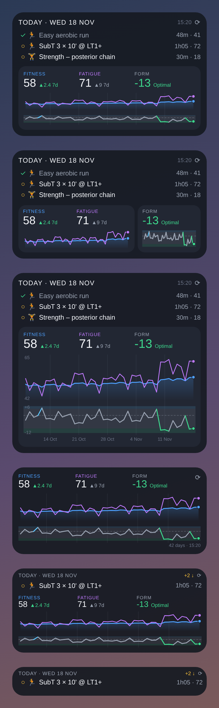

# Training Today: Android widget for intervals.icu

Four widgets that share one intervals.icu connection. You pick them from the widget picker:

| Widget | Default size | What it shows |
|---|---|---|
| **Training Today · Full** | 4×3 | Today's workouts with graphs underneath. Make it taller to list more workouts. |
| **Training Today · Trends** | 4×2 | Graphs only, with today's numbers. |
| **Training Today · Compact** | 4×2 | A one-row workout strip you can scroll, with the trend chart underneath. Workouts still to do come first. |
| **Training Today · Workouts** | 4×1 | A compact list you can scroll. At 1 row tall you see only the top workout. `+2 ↓` tells you how many more there are. |

### Per-widget settings

Long-press a widget and tap the **pencil (Settings)**. You can choose:

- **Graphs**
  - **Automatic** (the default): all three in one chart, on every widget.
  - **Three separate graphs**
  - **Fitness + Fatigue together, Form separate**
  - **All three in one chart:** Fitness and Fatigue on top, zone-coloured Form below. When the chart is tall enough it adds date and value labels.
- **Time period shown:** 2 weeks, 4 weeks, **6 weeks (default)**, 3 months, 6 months or 1 year.
  The 7-day change and today's numbers stay the same whatever period you choose.

Each widget keeps its own settings, so you can place two Trends widgets, for example one showing 6 weeks and one showing 1 year.

**Workouts:** `○` planned, `★` race, `✓` done. Each row shows duration and training load.

**Colours:**
- Fitness (CTL) is blue, and its 7-day change is green when it rises and red when it falls.
- Fatigue (ATL) is purple.
- Form (TSB = Fitness - Fatigue) is coloured by intervals.icu zone: High risk (< -30, red), Optimal (-30 to -10, green),
  Grey zone (-10 to 5, grey), Fresh (5 to 25, sky blue) and Transition (> 25, amber).

All widgets refresh every hour. Tap ⟳ to refresh them now. Tap workouts to open the intervals.icu calendar,
or tap charts to open the fitness page.

## Install

1. On your phone, open the **Releases** page of this repo and download `training-widget.apk` from
   *Training Today widget (latest build)*.
2. Open the file. Allow your browser or file manager to install unknown apps when Android asks.
3. Long-press your home screen, choose **Widgets** > **Training Today**, and drag out the widget you want: Full, Trends, Compact or Workouts.
   You can add several, and they all share the same login.
4. Enter your **Athlete ID** and **API key**. You can find both on intervals.icu under **Settings** > **Developer Settings**.
   Tap **Test and save**.

The key is stored only on the phone and is sent only to `intervals.icu`.

## Build

GitHub Actions (`.github/workflows/android-widget.yml`) builds the APK on every push that changes `android-widget/`.
To build locally, open this folder in Android Studio, or run `./gradlew assembleDebug`.

Every build is signed with the same key, `keystore/training-widget.jks`, and gets a higher version number, so a new APK
installs as an update. Your placed widgets and settings stay in place.

The repository is public, so anyone can read this key. It stops being a protection only if you install an APK from
somewhere other than this repo's release page. For stronger protection, move the keystore and its password into GitHub
Actions secrets.
