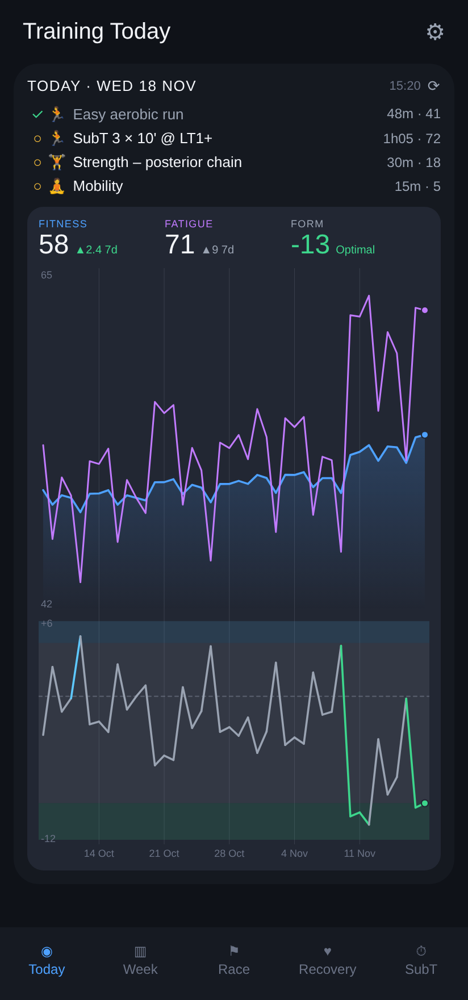

# Training Today: Android widget for intervals.icu

## The app

Opening **Training Today** shows the full view at full-screen size, with today's workouts above one large
Fitness / Fatigue / Form chart. Tabs along the bottom open the **Week**, **Race**, **Recovery** and **SubT** screens.
These are the same views as the widgets, drawn at full size. ⚙ opens your account settings.

Tapping a widget on your home screen opens the app on that widget's screen. Inside the app, taps open intervals.icu.

- **Week screen:** step back and forward with ‹ ›, or switch to **Month**, **3 months**, **6 months** or a **Custom** date range.
  It shows a bar per day, or a bar per week for long ranges, with Done, To do and Missed totals and the average per week.
  Underneath is a scrolling list of every session, grouped by day (✓ done, ○ planned, ★ race, ✕ missed).
- **Today and Recovery screens:** period chips (2 weeks to 1 year) or **Custom…** to pick a start date.
- **Today chart:** press and drag to read any day. The numbers switch to that day's Fitness, Fatigue and Form, and a crosshair marks it.
  Dotted gridlines label the values, and the Form panel shows its zone boundaries and names. The change shown next to each number covers the selected period.
- **Week bars:** green is the load done, with the number on top. Dashed grey is planned but missed, with the number inside. Amber is still planned.
  Above each finished day, ✓ means on plan (±10%), ˄ more than planned and ˅ less than planned.
- **Race:** a 3-month Fitness build-up chart. Peak, 12-week, 3-week, 1-week and race-day checkpoints show Fitness, Fatigue, Form and % of peak.
  Race day means the morning, which is the end of the day before. It also shows the taper target (drop from peak, set with chips), Form and Fatigue targets, and coach notes.
- **Recovery:** a readiness summary, then resting HR, HRV and sleep against your normal range, HR drift, Power:HR or efficiency, and SubT heart rate.
- **SubT tab** has four screens:
  - **Pace:** monthly pace and 5K goal ETAs.
  - **Analysis:** your latest SubT session rep by rep, plus pace, HR, efficiency and power trends for every rep over 5 weeks, with coach notes.
  - **Sub-3 forecast:** when SubT gets you to a sub-3 marathon, plus the 5K, HM and FM you can expect each month.
  - **Sub-3 plan:** pick a race date and target, and see the SubT, 5K and HM checkpoints you need each month.

  The forecast and plan include a body-weight scenario (−1, −0.5, −0.1 kg/week, stable, or +0.1 kg/week) that feeds every projection.

## Widgets

All widgets share one intervals.icu connection. You pick them from the widget picker:

| Widget | Default size | What it shows |
|---|---|---|
| **Full** | 4×3 | Today's workouts above the long combined chart. Make it taller to list more workouts. |
| **Trends** | 4×2 | Graphs only, with today's numbers. |
| **Compact** | 4×2 | A one-row workout strip you can scroll, with the trend chart underneath. Workouts still to do come first. |
| **Workouts** | 4×1 | A compact list you can scroll. `+2 ↓` tells you how many more there are. |
| **This week** | 4×2 | Load per day, Mon–Sun: done (green), still planned (amber) and missed (dashed). Shows totals compared with last week, and lists the remaining sessions when tall. |
| **Race countdown** | 2×2 | Days to your next A/B/C race and the projected race-day Fitness and Form (zone-coloured). Lists further races when tall. |
| **Recovery** | 4×2 | HRV, resting HR and last night's sleep. Each shows its 7-day average against your baseline and a trend line. |
| **SubT pace** | 2×2 | This month's median SubT lap pace, the change from last month, a monthly chart (faster plots higher) and a 6-month trend. It uses this repo's `data.json`, so it needs no login. |

**How the race projection works:** starting from today's Fitness and Fatigue, it adds the load of every planned workout
up to race day. It uses the standard 42-day and 7-day averages, the same model intervals.icu uses. It covers races up to
12 weeks away, and it's only as good as your planned workouts.

### Per-widget settings

Long-press a Full, Trends, Compact or Recovery widget and tap the **pencil (Settings)**. You can choose:

- **Graphs**
  - **Automatic** (the default): all three in one chart, on every widget.
  - **Three separate graphs**
  - **Fitness + Fatigue together, Form separate**
  - **All three in one chart:** Fitness and Fatigue on top, zone-coloured Form below. When the chart is tall enough it adds date and value labels.
- **Time period shown:** 2 weeks, 4 weeks, **6 weeks (default)**, 3 months, 6 months or 1 year.
  The 7-day change and today's numbers stay the same whatever period you choose.

Each widget keeps its own settings, so you can place two Trends widgets, for example one showing 6 weeks and one showing 1 year.

**Workouts:** `○` planned, `★` race, `✓` done. Each row shows duration and training load.

**Colours:**
- Fitness (CTL) is blue, and its 7-day change is green when it rises and red when it falls.
- Fatigue (ATL) is purple.
- Form (TSB = Fitness - Fatigue) is coloured by intervals.icu zone: High risk (< -30, red), Optimal (-30 to -10, green),
  Grey zone (-10 to 5, grey), Fresh (5 to 25, sky blue) and Transition (> 25, amber).

All widgets refresh every hour. Tap ⟳ to refresh them now. Tap workouts to open the intervals.icu calendar,
or tap charts to open the fitness page.

## Install

1. On your phone, open the **Releases** page of this repo and download `training-widget.apk` from
   *Training Today widget (latest build)*.
2. Open the file. Allow your browser or file manager to install unknown apps when Android asks.
3. Long-press your home screen, choose **Widgets** > **Training Today**, and drag out the widget you want: Full, Trends, Compact or Workouts.
   You can add several, and they all share the same login.
4. Enter your **Athlete ID** and **API key**. You can find both on intervals.icu under **Settings** > **Developer Settings**.
   Tap **Test and save**.

The key is stored only on the phone and is sent only to `intervals.icu`.

## Build

GitHub Actions (`.github/workflows/android-widget.yml`) builds the APK on every push that changes `android-widget/`.
To build locally, open this folder in Android Studio, or run `./gradlew assembleDebug`.

Builds are signed with a private key kept in two GitHub Actions secrets: `SIGNING_KEYSTORE_B64` (the keystore,
base64-encoded) and `SIGNING_PASSWORD`. Every build uses that same key and gets a higher version number, so a new APK
installs as an update and your placed widgets and settings stay. If the secrets are missing, CI falls back to the older
key in `keystore/`, which is public and due to be removed.
